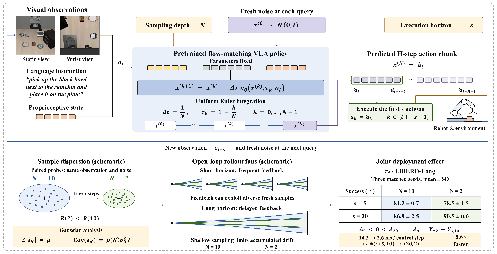
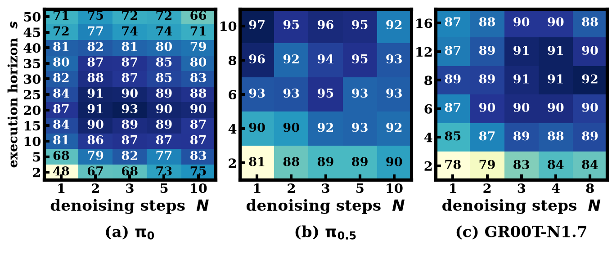

<div align="center">

# Coupling Execution Horizon and Sampling Depth in Flow-Matching VLA Policies

<a href="https://jiabingyang01.github.io/Commitment-VLA/"></a>
<a href="https://jiabingyang01.github.io/Commitment-VLA/paper.pdf"></a>
<a href="LICENSE.md"></a>

**[English](README.md) | [中文](README_zh.md)**

**Jiabing Yang**<sup>1,2,5</sup>, **Yuan Xu**<sup>1,2</sup>, **Yixiang Chen**<sup>1,2</sup>, **Qisen Ma**<sup>1,2</sup>, **Peiyan Li**<sup>1,2</sup>, **Kai Wang**<sup>1,2</sup>, **Chenhang Cui**<sup>3</sup>, **Tao Yu**<sup>1,2</sup>,  
**Zichen Wen**<sup>4</sup>, **Wen Ye**<sup>1,2</sup>, **Bowen Fang**<sup>1,2</sup>, **Ziheng He**<sup>1,2</sup>, **Xiangnan Wu**<sup>1,2</sup>, **Yingda Li**<sup>1,2</sup>, **Yan Huang**<sup>1,2,5,&dagger;</sup>, **Liang Wang**<sup>1,2</sup>

<sup>1</sup>School of Artificial Intelligence, University of Chinese Academy of Sciences &nbsp;&middot;&nbsp;
<sup>2</sup>NLPR, Institute of Automation, Chinese Academy of Sciences  
<sup>3</sup>National University of Singapore &nbsp;&middot;&nbsp;
<sup>4</sup>Shanghai Jiao Tong University &nbsp;&middot;&nbsp;
<sup>5</sup>FiveAges &nbsp;&middot;&nbsp;
<sup>&dagger;</sup>Corresponding Author

</div>

---

<p align="center">
  
</p>

## 📖 Overview

Flow-matching Vision-Language-Action (VLA) models generate expressive continuous trajectories for robotic manipulation, yet balancing real-time responsiveness with execution stability remains a persistent challenge. Standard deployment workflows treat numerical solver depth ($N$) and execution horizon ($s$) as decoupled choices.

In this work, we uncover a **fundamental compute–execution coupling** in flow-matching VLAs governed by a systematic **sign reversal**:
- **Short Execution Horizon ($s = 5$, Rapid Replanning):** Coarse numerical integration ($N = 2$) degrades task success relative to deep integration ($N = 10$), as frequent visual feedback corrects exploratory variations while truncation introduces step error.
- **Extended Execution Horizon ($s = 20$, Long Commitment):** Coarse numerical integration ($N = 2$) **markedly outperforms** deep integration ($N = 10$), improving task success while cutting inference latency by **2.6×–3.3×** entirely training-free.
- **Geometric Mechanism:** Forward Euler truncation contracts lateral trajectory dispersion around an nearly invariant trajectory centroid ($R(2)/R(10) = 0.51$), acting as an **implicit variance regularizer** that suppresses compounding open-loop drift.

---

## ✨ Key Results

| Benchmark | VLA Backbones | Key Finding |
| :--- | :--- | :--- |
| **LIBERO** (40 Tasks / 4 Suites, Seeds 7/8/9) | $\pi_0$, $\pi_{0.5}$, GR00T-N1.7 | Unanimous sign reversal on LIBERO-Long ($\pi_0$: $\Delta_{5} = -2.7\% \to \Delta_{20} = +3.7\%$, interaction $\mathcal{I} = \mathbf{+6.4\%}$); co-design $(20, 2)$ reaches **90.5%** on LIBERO-Long (**95.5%** overall average) at **2.6 ms** per step (**5.6×** speedup over $(5, 10)$). |
| **RoboTwin 2.0** (50 Bimanual Tasks, 100 Rollouts/Task) | $\pi_0$, $\pi_{0.5}$ | Significant sign reversal across 50 bimanual tasks on $\pi_{0.5}$ ($\mathcal{I} = \mathbf{+8.5\%}, p < 10^{-4}$); balanced co-design $(25, 2)$ achieves **3.5×** speedup while preserving $\pi_{0.5}$ success (**70.8%**) and boosting $\pi_0$ from **37.0%** to **45.7%**. |
| **Real-World Franka** (5 Tasks, 2,400 Trials) | $\pi_0$, $\pi_{0.5}$, GR00T-N1.7 | Across 40 matched trials per cell, full-horizon shallow sampling $(s=H, N=2)$ outperforms deep solvers across all four quasi-static tasks (**+10.0%** on $\pi_0$, **+6.9%** on $\pi_{0.5}$, **+11.3%** on GR00T-N1.7) while cutting compute by up to **25×**. |

<p align="center">
  
</p>

---

## 🗂️ Repository Structure

```text
Commitment-VLA/
├── docs/                  # Interactive project page (GitHub Pages source)
│   ├── index.html         # Main project website
│   ├── paper.pdf          # Camera-ready / arXiv manuscript PDF
│   └── assets/            # Figures, rollout videos, interactive JS charts & data
├── data/                  # Consolidated benchmark metrics & experimental master tables
│   ├── EXPERIMENTS.md     # Full experimental registry across LIBERO, RoboTwin 2.0 & Real-World
│   └── paper_data.js      # Structured JSON/JS data for interactive visualizations
└── scripts/               # Reproducible figure generation & statistical verification scripts
    ├── plot_phenomenon.py # Fig. 1: Sign-reversing coupling curves
    ├── plot_grid_abc.py   # Fig. 3: Cross-backbone & RoboTwin 2.0 heatmaps
    ├── plot_mechanism.py  # Fig. 4: Geometric dispersion contraction & interventions
    ├── verify_table1.py   # Statistical verification for Table I (LIBERO)
    └── verify_table3.py   # Statistical verification for Table III (Mechanism & Ablations)
```

---

## 🚀 Quick Start: Deploying Coupled $(s, N)$ in Flow-Matching VLAs

Our findings require **zero retraining or architectural modification** and can be applied directly to existing flow-matching VLA inference loops (`openpi` / $\pi_0$ / $\pi_{0.5}$ / `Isaac-GR00T`):

```python
# Standard OpenPI / Flow-Matching VLA Inference Configuration
# Instead of default decoupled setting: execution_horizon s = 5, num_steps N = 10
# Use coupled regime matching your control horizon:

# Option A: Balanced Pareto Frontier (LIBERO / Tabletop)
EXECUTION_HORIZON = 10   # Execute 10 actions open-loop per chunk
SAMPLING_DEPTH    = 2    # 2-step forward Euler integration (3.3x faster, +2.0 pp on LIBERO-Long)

# Option B: Extended Commitment / Real-World High-Latency Regime
EXECUTION_HORIZON = 20   # Execute 20 actions open-loop per chunk
SAMPLING_DEPTH    = 2    # Implicit variance contraction suppresses open-loop drift (+23.0 pp on Franka)

action_chunk = policy.sample_actions(
    observation=obs,
    num_steps=SAMPLING_DEPTH,   # Forward Euler steps N
)
executed_prefix = action_chunk[:EXECUTION_HORIZON]
```

To reproduce the paper figures and statistical verification checks:

```bash
python3 scripts/verify_table1.py
python3 scripts/verify_table3.py
python3 scripts/plot_phenomenon.py
python3 scripts/plot_grid_abc.py
python3 scripts/plot_mechanism.py
```

---

## 📝 Citation

If you find our empirical findings or analysis useful in your research, please consider citing:

```bibtex
@article{yang2026coupling,
  title   = {Coupling Execution Horizon and Sampling Depth in Flow-Matching VLA Policies},
  author  = {Yang, Jiabing and Xu, Yuan and Chen, Yixiang and Ma, Qisen and Li, Peiyan and Wang, Kai and Cui, Chenhang and Yu, Tao and Wen, Zichen and Ye, Wen and Fang, Bowen and He, Ziheng and Wu, Xiangnan and Li, Yingda and Huang, Yan and Wang, Liang},
  journal = {arXiv preprint},
  year    = {2026}
}
```
